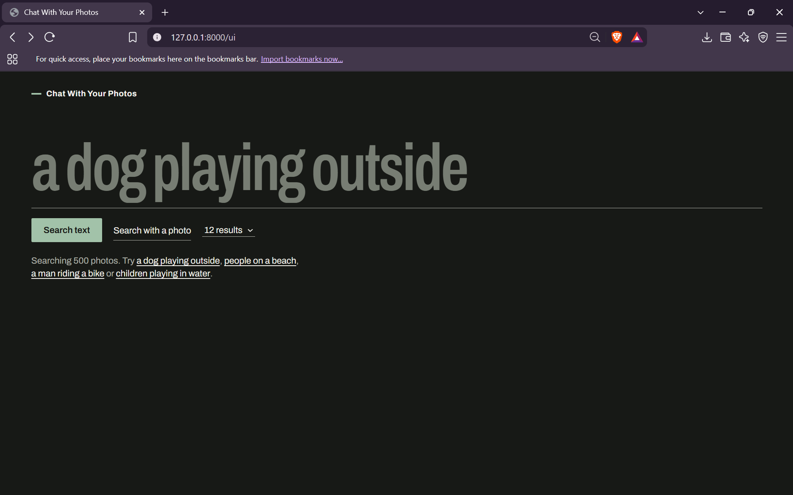

# Chat With Your Photos

Search a photo collection by describing what you want in plain words, or by uploading a photo. Results are ranked by semantic similarity, not by filenames or tags.



## How it works

```
Photos --> CLIP image encoder --> 512-d vectors --> normalize --> FAISS index (built once)

Text query  --> CLIP text encoder  --\
                                      +--> normalize --> FAISS search --> ranked photos
Uploaded photo --> CLIP image encoder -/
```

CLIP maps images and text into the same vector space, so a sentence and a photo that match end up close together. Vectors are normalized, which makes the inner-product search in FAISS equal to cosine similarity. The index is built once in a notebook and loaded when the API starts.

## Features

- Text-to-photo search ("a dog playing outside")
- Photo-to-photo search (upload an image, get similar ones)
- Ranked results with similarity scores
- Full-screen viewer with keyboard navigation
- JSON API with interactive docs

## Tech stack

Python, PyTorch, Hugging Face Transformers (`openai/clip-vit-base-patch32`), FAISS (`IndexFlatIP`), FastAPI and Uvicorn, plain HTML/CSS/JS for the frontend.

## Run it locally

The photos are not included in this repository (see [Dataset](#dataset-and-license)), so the app needs them in place before the image grid works.

```bash
git clone https://github.com/aviskha23/chat-with-your-photos.git
cd chat-with-your-photos
python -m venv .venv
.venv\Scripts\activate          # macOS/Linux: source .venv/bin/activate
pip install -r requirements.txt

# Put the 500 images in images/images/ (filenames must match filenames.json)

python -m uvicorn main:app --reload
```

Open http://127.0.0.1:8000/ui for the interface, or http://127.0.0.1:8000/docs for the API docs. The first start downloads the CLIP weights (about 600 MB).

## API

| Endpoint | Description |
|---|---|
| `GET /` | Status and number of indexed photos |
| `GET /search-by-text?q=...&top_k=12` | Search with a text description |
| `POST /search-by-image?top_k=12` | Search with an uploaded image (multipart `file`) |
| `GET /image/{filename}` | Serve a photo |
| `GET /ui` | Web interface |

Each result contains `rank`, `image_id`, `filename`, `score` and `image_url`.

## Search quality and limitations

I tested 10 queries against the 500-photo index and rated the top results by eye (`quality_check.py` generates the report).

| Query | Top-1 score | Verdict |
|---|---:|---|
| a dog playing outside | 0.327 | Good |
| people on a beach | 0.291 | Good |
| a man riding a bike | 0.309 | Good |
| someone reading a sign | 0.268 | Good |
| loneliness | 0.253 | Good |
| a woman in a red dress | 0.273 | Mixed |
| two people sitting on a bench | 0.328 | Mixed |
| a street with no cars | 0.281 | Mixed |
| a dog to the left of a bicycle | 0.267 | Poor |
| asdkjhqwe (nonsense) | 0.236 | Poor, as expected |

What I learned:

- CLIP is strong on overall content and mood, and weak on relationships between things: counting, negation and left/right position.
- Similarity scores are not confidence values. Top-1 scores only ranged from 0.236 (nonsense) to 0.328 (best real query), so no fixed cutoff separates good matches from bad ones. Only the ranking is reliable.
- The search always returns the nearest photos, even when nothing matches.
- With only 500 photos, some weak results may come from missing content in the dataset rather than from the model. [Edit: say which you believe for the poor and mixed rows.]

## Rebuilding the index

`CLIP.ipynb` contains the full pipeline: loading the dataset, embedding in batches, normalizing, building the FAISS index, and saving `embeddings.npy`, `filenames.json`, `image_ids.json` and `clip.index`.

## Project structure

```
main.py             FastAPI app (search endpoints, image serving, UI route)
static/index.html   Frontend
clip.index          FAISS index (500 vectors)
embeddings.npy      Normalized CLIP image embeddings
filenames.json      Filename for each vector, in index order
image_ids.json      Dataset id for each vector, in index order
CLIP.ipynb          Embedding and indexing pipeline
quality_check.py    Runs test queries and builds a review page
```

## Dataset and license

The index was built from a 500-image subset of Flickr30k. Flickr30k is provided for non-commercial research use, so the images are not redistributed here. Please obtain them from the dataset's official source and follow its terms.

## Roadmap

- [ ] Auto-captioning with BLIP and questions about the retrieved photos
- [ ] Docker image
- [ ] Public demo
